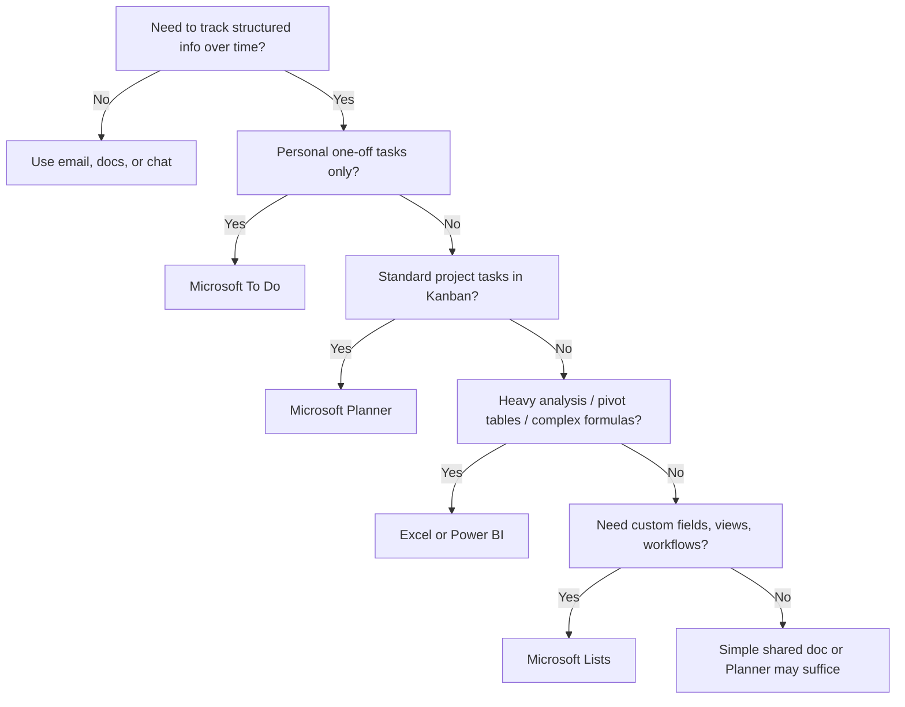

# When to Use Lists (and When Not To)

## Decision flowchart

## Comparison table

| Need | Best tool | Why |
|------|-----------|-----|
| My daily personal tasks | **To Do** | Fast, personal, minimal structure |
| Team sprint tasks, buckets | **Planner** | Built for task boards and assignments |
| Inventory, tickets, assets, custom process | **Lists** | Flexible schema + views + automation |
| Financial modeling, charts, pivots | **Excel** | Formula power and analysis |
| Document library + pages + lists | **SharePoint site** | Full intranet site |
| Enterprise CRM, ERP | **Dynamics / dedicated app** | Lists is not a replacement |

## Lists shines when...

- Multiple people update the same dataset regularly
- You need **consistent fields** (dropdowns, people pickers, dates)
- You want **different views** of the same data (grid + calendar + board)
- You need **light automation** (rules, Power Automate)
- The data fits **thousands** of rows, not millions
- You want Teams integration without building an app

## Lists struggles when...

- You need complex relational data (many linked tables with joins)
- Heavy numerical analysis or macros
- Offline-first mobile use as primary workflow
- Strict regulatory audit beyond what SharePoint provides
- Sub-second search across millions of records
- Public anonymous submission at scale (consider Forms + Lists with planning)

## Lists vs Excel (the most common question)

| Aspect | Excel | Lists |
|--------|-------|-------|
| Collaboration | Co-authoring improved but file-centric | Native multi-user, version in cloud |
| Structure | Any cell anything | Typed columns |
| Views | Sheets, filters | Saved views, board, calendar |
| Automation | VBA, scripts | Rules, Power Automate |
| Permissions | File-level | Item/list/site level |
| Best for | Analysis, one-time models | Ongoing operational tracking |

**Migration signal:** "We're emailing an Excel file every week and people overwrite each other's rows" → try Lists.

## Lists vs SharePoint lists

They're the **same data layer**. The Lists app is a simplified experience. Use SharePoint directly when you need:

- Advanced list settings only in classic SharePoint admin UI
- Content types and site columns across many lists
- Complex permission inheritance at site level

For learning and daily use, stay in the **Lists app** until you hit a wall.
